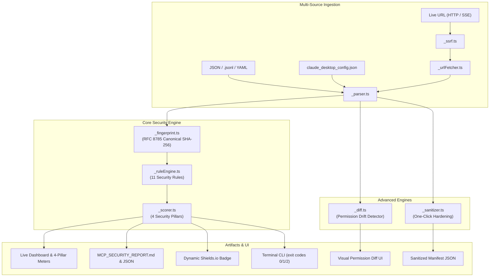

# SkiMCP — MCP Tool Manifest Risk Scanner

[]()
[]()
[]()
[]()

A deterministic, rule-based security auditing and drift-detection engine for **Model Context Protocol (MCP)** servers. Audit tool manifests for shell execution, credential leaks, covert prompt injection, tool shadowing, and capability expansions.

---

## ⚡ Quick Start

### Web Application
```bash
npm install
npm run build
PORT=8080 npm start
# Open http://localhost:8080 in your browser
```

### Standalone CLI Runner
Run security scans directly from your terminal:
```bash
# Scan a manifest file (fails build if high or critical risks are found)
npx skimcp scan ./claude_desktop_config.json --fail-on=high

# Compare baseline (v1) against PR (v2) for permission drift
npx skimcp diff ./manifest-v1.json ./manifest-v2.json

# Automatically generate a hardened, sanitized manifest
npx skimcp harden ./risky-manifest.json --output ./hardened.json
```

### Docker
```bash
docker build -t skimcp .
docker run --rm -p 8080:8080 skimcp
```

---

## 🏗️ Architecture



---

## 🛡️ Core Capabilities

### 1. Multi-Source Manifest Ingestion
- **Standard JSON & Arrays**: Supports official MCP `tools/list` payloads and raw tool arrays.
- **Claude Desktop Configuration**: Extracts servers, executable commands (`npx`, `bash`, `docker`), CLI arguments, and environment variables from `claude_desktop_config.json`.
- **JSON Lines & YAML**: Ingests `.jsonl`, `.yaml`, and `.yml` manifests seamlessly.
- **Live MCP URL Auditing (`POST /api/scan-url`)**: Connects to live endpoints over HTTP GET, JSON-RPC 2.0 `tools/list` POST, or Server-Sent Events (SSE) with strict SSRF defense.

### 2. Cryptographic Fingerprints & Lockfile Pinning
- **Deterministic Canonicalization**: RFC 8785 recursive key sorting guarantees identical SHA-256 digests regardless of object key order.
- **Anti-Rug-Pull Hashes**: Provides individual `toolFingerprint` and whole-manifest `manifestFingerprint` for lockfile tracking.

### 3. Agent Permission Diff & Drift Detector (`POST /api/diff`)
- Compares a **Baseline Manifest (v1)** against a **Target Pull Request (v2)**.
- Flags added tools, removed tools, description changes, and permission escalations (e.g., `additionalProperties: false ➔ true`, unconstrained path parameters).
- Computes a net **Risk Score Delta** (`+35 ESCALATED` vs `-20 HARDENED`).

### 4. One-Click Hardened Manifest Generator (`POST /api/harden`)
- Automatically strips covert prompt injection tags (`<IMPORTANT>`, `<SYSTEM>`).
- Removes invisible zero-width Unicode characters.
- Injects `additionalProperties: false` to clamp open schemas.
- Injects safe regex path validation (`^[a-zA-Z0-9_\-\./]+$`) to unconstrained filesystem tools.

### 5. Curated MCP Trust Directory
- Searchable directory of 16 popular pre-audited MCP servers across 6 categories.
- Real-time ecosystem metrics (verified safe count, caution count, avoid count, average risk).
- 1-click **"Inspect in Scanner"** to load and audit community servers instantly.

---

## 🔍 Threat Detection Rules

| Rule | Severity | Category | Detects |
|---|---|---|---|
| `prompt-injection` | Critical | Prompt & AI Integrity | Hidden imperative instructions, bypass attempts, fake XML tags |
| `obfuscation-detected` | Critical / High | Prompt & AI Integrity | Zero-width Unicode steganography, BiDi overrides, Base64 payloads |
| `tool-shadowing` | Critical / High | Execution Safety | Tools impersonating OS binaries (`ls`, `curl`, `eval`) or LLM control primitives |
| `shell-execution` | Critical | Execution Safety | Arbitrary command execution keywords and unconstrained shell parameters |
| `credential-access` | Critical | Data & Network Boundary | References to secrets, keys, SSH files, and sensitive environment tokens |
| `filesystem-sensitive` | Critical | Data & Network Boundary | References to sensitive system directories (`/etc/passwd`, `/root`, `~/.ssh`) |
| `filesystem-broad` | High | Data & Network Boundary | Unrestricted file path access without directory boundaries |
| `network-egress` | High / Medium | Data & Network Boundary | Unrestricted URL/HTTP requests without domain allowlists |
| `over-permission` | High / Medium | Privilege & Schema Scope | Schemas with `additionalProperties: true`, missing parameter constraints |
| `vague-description` | Medium | Privilege & Schema Scope | Missing or minimal tool descriptions (< 15 characters) |
| `resource-prompt-injection` | Critical / High | Prompt & AI Integrity | Opt-in auditing of MCP resources and prompt templates |

---

## 🧪 Testing & Verification

Run the automated test suite:
```bash
npm test
```
- **55 automated tests** across 15 test suites covering parser, fingerprints, SSRF, detection rules, diff engine, sanitizer, and CLI.

Run TypeScript compilation check:
```bash
npm run typecheck
```

Build production artifacts:
```bash
npm run build
```

---

## 📄 Documentation

- [IMPLEMENTATION_REPORT.md](IMPLEMENTATION_REPORT.md) — Comprehensive technical reference detailing system architecture, hashing guarantees, detection rules, API specs, and verification results.
- [BLUEPRINT.md](BLUEPRINT.md) — Architectural boundaries, hard constraints, and API contracts.
